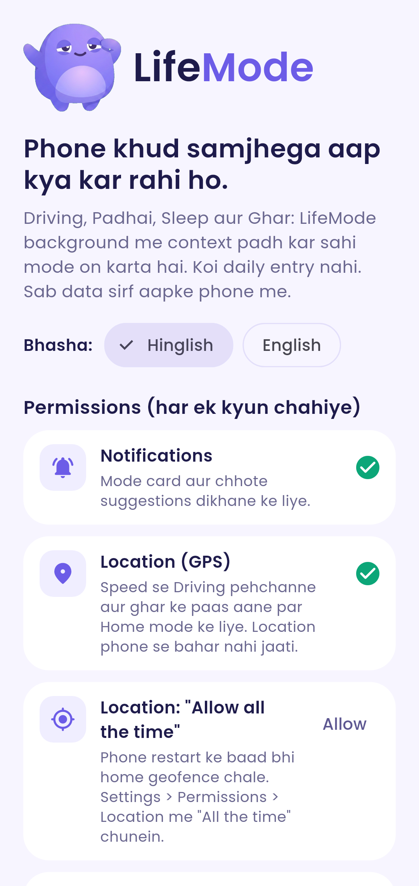
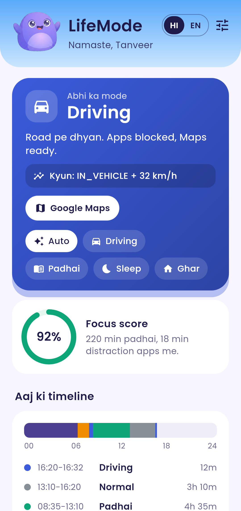
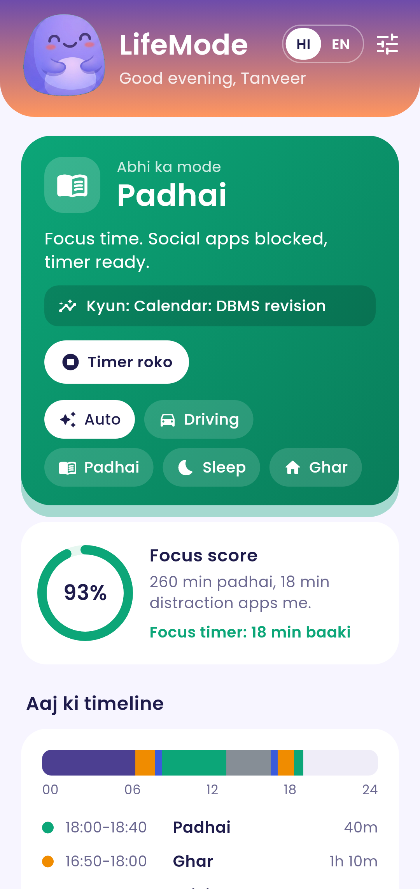
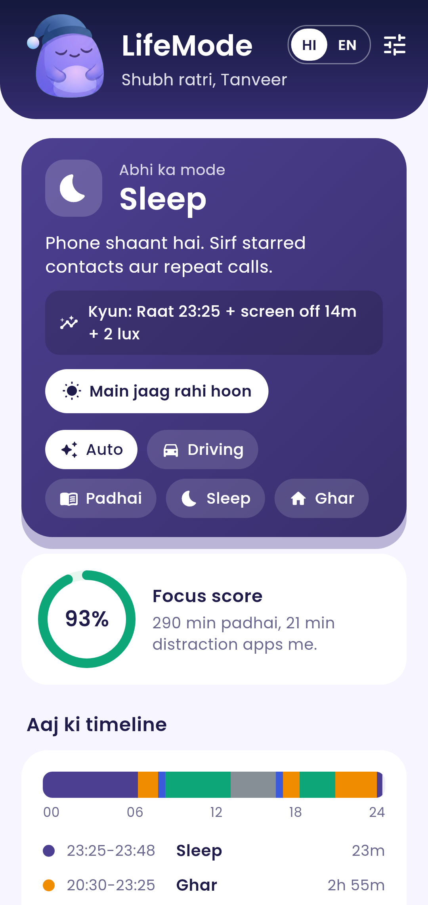
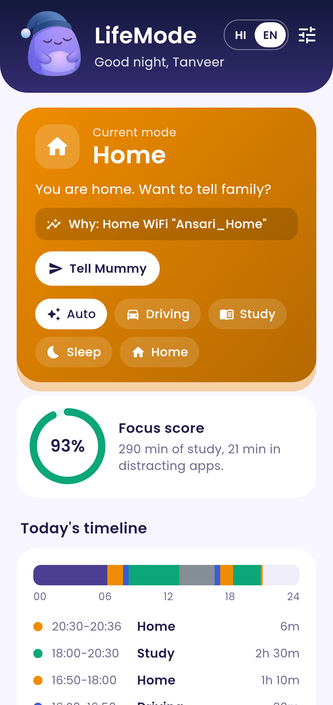
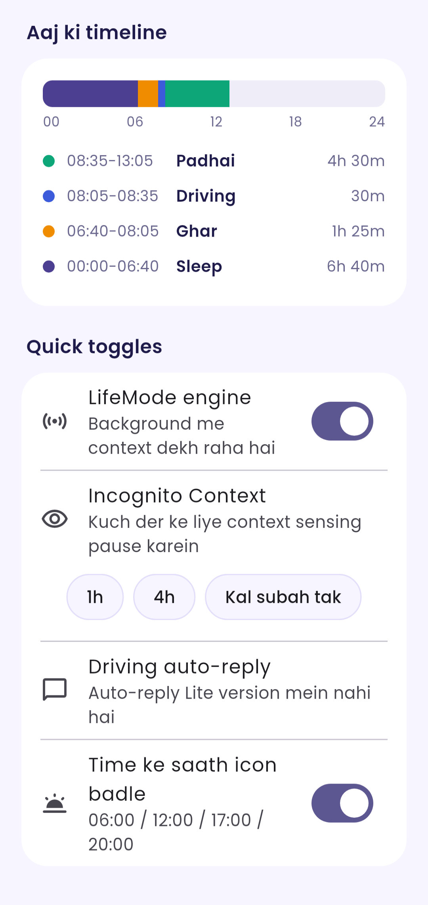
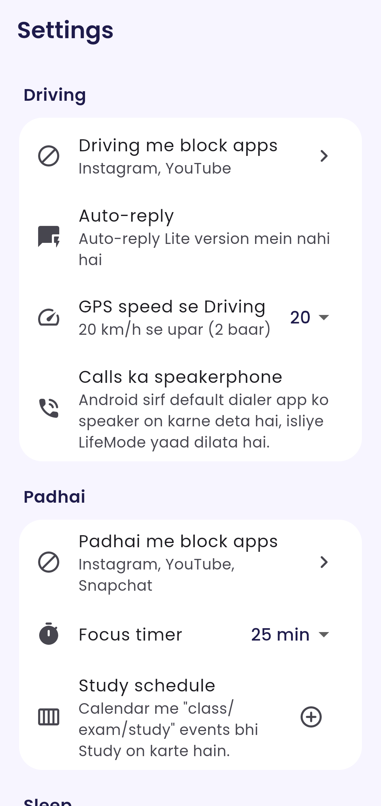

<p align="center"></p>

**LifeMode** is an ambient-computing Android app (Flutter + native Kotlin). It reads your phone's context in the background (motion, GPS speed, WiFi, screen, app usage, calendar, light, time) and switches the phone into the right **Life Mode** by itself: **Driving, Study (Padhai), Sleep or Home**. It only offers small, useful notifications and actions. No daily data entry, no account, no server.

UI in **Hinglish** (default) or **English**, switchable from the header.

> **v1.0.1 "Lite".** Google Play Protect's *enhanced fraud protection* (India) blocks
> apps installed from a browser, WhatsApp or a file manager when they declare
> `RECEIVE_SMS`, `READ_SMS`, a Notification Listener or an Accessibility service.
> The Lite build drops all of these so the APK installs from Chrome without that block,
> and upgrades over v1.0 (same package `com.tanveer.lifemode`, same signing key).
>
> **Removed in Lite**
> - **Driving auto-reply** to WhatsApp/Instagram (needed `NotificationListenerService`). Driving now shows *"Auto-reply Lite version mein nahi hai"*.
> - **Optional Accessibility blocker** (instant blocked-app detection). Blocking now uses UsageStats polling only (about 1.5 s delay).
>
> Never requested (and stripped with `tools:node="remove"` if a library tries to add them):
> SMS read/receive/send, call log, phone state, `QUERY_ALL_PACKAGES` (app list comes from `<queries>` intents),
> `REQUEST_INSTALL_PACKAGES`. The family message is still a prefilled WhatsApp/SMS intent: you press send, no permission needed.
>
> `SYSTEM_ALERT_WINDOW` ("Display over other apps") is **kept, and optional**: Android 10+ does not let a
> background service open an Activity (our own full-screen block screen) without it. No overlay window is drawn.
> Without it, a blocked app triggers a high-priority notification that opens the block screen instead.

<p align="center"></p>

| Onboarding | Driving | Study | Sleep | Home (English) | Toggles | Settings |
|---|---|---|---|---|---|---|
|  |  |  |  |  |  |  |

## The 4 modes

Each mode has notification control, app blocking (or a reminder), a smart action, and a dashboard card. The mode is picked automatically; a chip row gives a **manual override** (2 h) and every card shows a **"why" line**, e.g. `Kyun: IN_VEHICLE + 32 km/h`.

| Mode | Detected from | What it does |
|---|---|---|
| **Driving** | Play Services Activity Recognition **Transition API** (`IN_VEHICLE`), with **GPS speed fallback** (2 samples above 20 km/h). Stays on through 3 min of red lights. | DND (priority: starred contacts + repeat callers). Chosen apps blocked with a full-screen **"Driving Mode on"** shield. *(Auto-reply is not in the Lite build.)* Persistent **Open Google Maps** shortcut. "I'm a passenger" button. |
| **Study / Padhai** | Calendar event happening now whose title has class / exam / test / study / lecture / lab / padhai / tuition / viva…, your weekly study schedule, or a running focus timer. | Social apps blocked (shield with "Back to focus" / "Open for 2 min"). **Pomodoro** focus timer as a countdown notification. Gentle vibration + nudge when the phone is picked up during focus (max every 5 min). **Daily focus %** = study time not spent in blocked apps (UsageStats). |
| **Sleep** | Inside your night window + screen off 10 min + phone still (accelerometer) + dark (light sensor). Survives quick 3 am time checks; wakes after 5 min of use. | DND with **starred contacts + repeat callers** (+ alarms). **Alarm readiness** (`AlarmManager.getNextAlarmClock`). **"Kal ke important kaam"** from tomorrow's calendar. "Ab so jao" nudge for late-night scrolling (before Sleep starts). |
| **Home** | Home **WiFi SSID** or **home geofence** (Play Services Geofencing) / GPS distance, with drift hysteresis. | Notification with **"Main ghar pahunch gayi" → family contact** as a **prefilled WhatsApp/SMS** (you press send; never silent). **Charger reminder** under 40 %. Your own reminders (geyser, gate lock…). |

### Proactive rule engine (on-device)
At most **1 suggestion per 30 min**, nothing during Sleep/Driving except critical ones, plus per-rule cooldowns:
- **Late-night scrolling** (20+ min of screen inside the night window) → "Ab so jao", one tap to Sleep mode.
- **Excessive app switching** (25+ switches in 10 min) → offer a focus session.
- **Battery ≤ 15 % outside home** (critical) → *"Power-saving + location share karun?"*: opens Battery Saver and a prefilled message with a Maps link to your family contact.
- **Unusual routine** → much later than your usual home arrival (median of the last 14 days) → offer to update family.
- **No alarm before an early event tomorrow** (critical) → open the alarm app.

### Dynamic launcher icon
A text-free mascot in 4 variants (**morning** sunrise and opening eyes, **afternoon** bright, **evening** sunset and relaxed, **night** moon and sleepy). Each is an **adaptive icon** (background + foreground + monochrome layer for themed icons). The icon switches through `<activity-alias>` components at **06:00 / 12:00 / 17:00 / 20:00** from a WorkManager job, with an on/off switch. The current mascot is animated in the app header.

Honest limits:
- Some launchers refresh, briefly move or re-sort the icon when it changes, and a few need a moment to show the new one. To avoid closing the app on screen, LifeMode switches only while the app is not in the foreground.
- **Live-animated launcher icons are not possible on Android.** Only the in-app header is animated.
- WorkManager timing is approximate (Doze can delay it by some minutes). The service also re-checks the icon.

## Privacy
- **Everything stays on the phone.** Timeline and suggestion log in a local SQLite DB (sqflite), settings in app-private storage. LifeMode sends nothing over the internet: no account, no analytics, no cloud.
- **Per-sensor toggles**: location, activity, WiFi, motion, light, app usage, calendar, mic.
- **Mic is OFF by default.** When on, it reads 0.5 s of audio into memory every ~2 min, keeps one loudness number (dB) and discards the samples. It never records or saves audio.
- **Incognito Context Mode**: pause all sensing for 1 h, 4 h or until tomorrow morning; nothing is logged.
- No location history is stored; only mode changes ("Driving at 08:05, reason …").
- LifeMode Lite cannot read your notifications or screen at all (no Notification Listener, no Accessibility service).
- **Export** (JSON via share sheet) and **Delete all data** in Settings.

## Permissions (each explained in-app, in Hinglish)
| Permission | Why | Required? |
|---|---|---|
| Notifications | mode card, suggestions | yes |
| Location (fine) | GPS speed for Driving, home distance, WiFi SSID | for Driving fallback + Home |
| Background location ("Allow all the time") | home geofence keeps working after reboot | optional |
| Physical activity | Activity Recognition (IN_VEHICLE, WALKING, STILL) | for Driving |
| Usage access | which app is in front (blocking), focus %, app switching, scrolling | for blocking |
| Display over other apps | lets the service open its own block screen from the background (Android 10+); without it you get a notification instead | optional, recommended for blocking |
| Do Not Disturb access | Sleep/Driving DND (starred + repeat callers) | for DND |
| Calendar | Study detection, tomorrow's tasks | optional |
| Ignore battery optimisation | keeps the service alive on Xiaomi/Oppo/Vivo/Samsung | recommended |
| Microphone (optional, off) | loudness only | optional |

## Honest limits
- **Auto-speakerphone is not possible.** Android only lets the *default dialer* app turn speaker on, so Driving shows a reminder instead ("Calls: speaker ya Bluetooth khud on karein").
- **DND exceptions**: Android's DND lets apps choose *starred contacts* and *repeat callers*, not an arbitrary contact list. Star your important contacts in the Contacts app.
- **No auto-reply in Lite.** It needs Notification access, which Play Protect blocks for sideloaded apps in India.
- **Blocking** polls UsageStats every 1.5 s, so a blocked app can be visible for about a second before the shield appears.
- **Activity Recognition** can take 30–90 s to report `IN_VEHICLE`. Passengers (bus, cab) are also "in vehicle": use **"I'm a passenger"**.
- **Battery saver** cannot be turned on by a normal app; LifeMode opens the setting for you.
- After a **reboot**, Android 14+ does not let a location-type service start in the background without "Allow all the time" location. LifeMode then starts in reduced mode (no GPS) until you open the app once.
- Aggressive OEM battery managers can still kill the service. Turn off battery optimisation for LifeMode (WorkManager also restarts it as a watchdog).

## Architecture
```
lib/
  core/            pure Dart, unit-tested
    models.dart        LifeMode, LifeConfig, ContextSnapshot, ModeDecision, Suggestion
    context_engine.dart  snapshot + config -> mode + "why" (priority, hysteresis)
    rule_engine.dart     proactive suggestions + rate limits, focus %
    brain.dart           one tick: decision + localized notification content
    icon_schedule.dart   06/12/17/20 icon variants
    timeline.dart        today's mode segments
  background.dart  headless entrypoint run by the Kotlin service (tick -> decision, logs to sqflite)
  data/db.dart     sqflite store (timeline, suggestions, export/delete)
  platform/native_bridge.dart   MethodChannel 'lifemode/native' + EventChannel 'lifemode/status'
  state/, ui/      dashboard, onboarding (permissions), settings, app picker
android/app/src/main/kotlin/com/tanveer/lifemode/
  ContextService.kt   foreground service (location | specialUse/dataSync): sensors, GPS, screen, battery,
                      calendar, UsageStats, mic amplitude; ticks every 20 s; applies DND, blocking, notifications, Pomodoro
  BgEngine.kt         headless FlutterEngine running backgroundMain (same Dart engines as the app)
  Receivers.kt        Activity Transition + Geofence + BOOT_COMPLETED receivers
  BlockActivity.kt    full-screen shield, opened by the UsageStats poll loop (Blocker in ContextService.kt)
  IconSwitcher.kt     activity-alias switching + WorkManager job (also a service watchdog)
  Perms.kt, Notifs.kt, Store.kt, MainActivity.kt
```
The decision logic lives once, in Dart. The service builds a context snapshot every 20 s (or on screen/activity/geofence events) and asks the headless Dart engine for the mode, so the tested code is the code that runs.

## Build
Requirements: Flutter 3.47+, JDK 17, Android SDK 36. Gradle 9.3.1, AGP 9.1.0, Kotlin 2.4.0 (Kotlin-script Gradle).
```bash
flutter pub get
flutter analyze
flutter test                                    # unit + widget tests
flutter test --update-goldens test/screenshots_test.dart   # README screenshots
# release signing: put key.properties (storePassword, keyPassword, keyAlias, storeFile) in android/ (git-ignored)
flutter build apk --release                     # universal APK, minSdk 24
```
Without `android/key.properties` the release build falls back to debug signing.

## Testing on a device (checklist)
1. Install, go through onboarding, allow at least Notifications, Location, Physical activity, Usage access, Display over apps, DND access.
2. **Home**: Settings → Ghar → "Yahi ghar hai" while at home (saves GPS + WiFi). Leave and come back: the Home notification with "Mummy ko bhejo" should appear.
3. **Driving**: take a ride; within ~1–2 min the card should show `IN_VEHICLE` or `GPS xx km/h`. Open Instagram → shield (or a notification if Display over apps is off).
4. **Study**: add a calendar event "DBMS class" now, or tap the Padhai chip → open a blocked app → shield; start the 25 min timer.
5. **Sleep**: at night, screen off 10+ min in a dark room → DND on, alarm line + tomorrow's tasks in the notification.
6. **Icon**: wait for 12:00/17:00/20:00 with the app closed (or toggle the switch off/on).

## License
MIT © 2026 Tanveer Ansari
